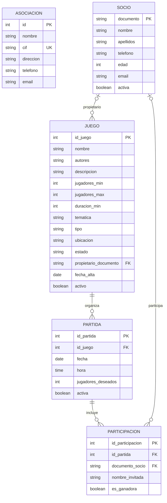

# Memoria del proyecto: Gestión de una asociación de juegos de mesa

## 1. Introducción

### 1.1. Descripción del proyecto

El proyecto consiste en una aplicación de consola desarrollada en Java para gestionar la información de una asociación de juegos de mesa. La aplicación permite mantener los datos de la asociación, administrar socios y juegos, organizar partidas y controlar las personas inscritas en ellas. También incorpora consultas del historial de actividad de los socios, estadísticas y exportación de información a formatos JSON y XML.

Los datos persistentes se almacenan en una base de datos relacional MariaDB, accesible mediante JDBC. La configuración de conexión se mantiene separada del código fuente mediante variables de entorno y un archivo `.env` para el entorno de desarrollo.

### 1.2. Objetivos

Los principales objetivos del proyecto son:

- Centralizar la información de una asociación y de sus socios.
- Mantener un catálogo de juegos con sus características, estado y propietario.
- Crear, consultar, modificar y cancelar partidas.
- Registrar tanto socios como personas invitadas en las partidas.
- Registrar los resultados de las partidas e identificar a las personas ganadoras.
- Consultar el historial de actividad y obtener estadísticas para un periodo determinado.
- Exportar determinados conjuntos de datos a JSON y XML.
- Separar las responsabilidades de interacción con el usuario, lógica de acceso a datos y representación de las entidades.
- Facilitar la configuración y la puesta en marcha en distintos entornos.

### 1.3. Alcance

La aplicación está orientada a la gestión de una asociación mediante menús de texto. No incluye una interfaz gráfica ni una aplicación web. Las operaciones de gestión se realizan desde la consola y los datos se guardan en MariaDB/MySQL.

La exportación implementada contempla socios, juegos y partidas. La exportación de estos objetos no implica necesariamente que se incluyan todos los datos relacionados con ellos, como el conjunto completo de participantes de cada partida.

## 2. Requisitos del sistema

### 2.1. Requisitos de software

- **Java Development Kit (JDK) 21**, requerido por la configuración de compilación de Maven.
- **Apache Maven**, para resolver dependencias y compilar el proyecto.
- **MariaDB o un servidor compatible con MySQL**, para almacenar los datos.
- **Un entorno de desarrollo Java**, por ejemplo IntelliJ IDEA, o una herramienta equivalente.
- **Conectividad con el servidor de base de datos**, mediante la red local o una red privada si la base de datos está alojada en otro equipo.
- **Docker y Docker Compose**, únicamente si se desea utilizar la configuración de contenedor incluida en el proyecto para levantar MariaDB.

### 2.2. Dependencias principales

Las dependencias se declaran en `pom.xml`. Entre las principales se encuentran:

| Dependencia | Versión declarada | Finalidad |
|---|---:|---|
| `org.mariadb.jdbc:mariadb-java-client` | 3.5.2 | Conexión JDBC con MariaDB. |
| `com.fasterxml.jackson.core:jackson-databind` | 2.18.3 | Serialización y deserialización de JSON. |
| `com.fasterxml.jackson.dataformat:jackson-dataformat-xml` | 2.18.3 | Escritura de documentos XML. |
| `com.fasterxml.jackson.datatype:jackson-datatype-jsr310` | 2.18.3 | Soporte para tipos de fecha y hora de Java. |
| `io.github.cdimascio:dotenv-java` | 3.2.0 | Lectura de variables de configuración desde `.env`. |

Maven descarga estas bibliotecas cuando construye el proyecto, por lo que no es necesario incorporarlas manualmente al repositorio.

### 2.3. Requisitos de hardware

No se han definido requisitos específicos de hardware. Es suficiente con un equipo capaz de ejecutar Java 21 y Maven, además de disponer de acceso a la base de datos. Si MariaDB se ejecuta en otro equipo, el equipo cliente no necesita alojar también el servidor de base de datos.

## 3. Puesta en marcha

### 3.1. Preparación del entorno

1. Instalar un JDK compatible con Java 21.
2. Instalar Maven o utilizar la herramienta Maven integrada en el IDE.
3. Clonar o descargar el repositorio y abrir el directorio raíz del proyecto.
4. Preparar una instancia de MariaDB/MySQL, local o remota.
5. Configurar las variables de conexión antes de ejecutar la aplicación.

### 3.2. Creación e inicialización de la base de datos

El script de inicialización se encuentra en:

`src/main/java/org/example/docker/init.sql`

El script define las tablas `asociacion`, `socio`, `juego`, `partida` y `participacion`, sus claves principales, las claves externas y varias restricciones de integridad. También incluye datos iniciales de ejemplo. El script no crea explícitamente la base de datos; esta debe existir antes de ejecutarlo cuando se inicializa una instancia manualmente.

En una instalación manual, se debe crear la base de datos y seleccionar ese esquema antes de ejecutar el script. Por ejemplo, con una cuenta administradora:

```sql
CREATE DATABASE asociacion_juegos
    CHARACTER SET utf8mb4
    COLLATE utf8mb4_unicode_ci;

USE asociacion_juegos;
```

Después se ejecuta el contenido de `init.sql`. Si se utiliza una base de datos que ya contiene información, hay que revisar el script antes de volver a lanzarlo y hacer una copia de seguridad si procede.

El proyecto también incluye el archivo `src/main/java/org/example/docker/docker-compose.yml`, que configura un contenedor MariaDB 11.4, publica el puerto 3306, mantiene los datos en un volumen persistente y monta el script de inicialización. La imagen oficial ejecuta los scripts de inicialización al crear por primera vez el directorio de datos; modificar el SQL después de crear el volumen no implica que ese script vuelva a ejecutarse automáticamente.

Para utilizar la configuración Docker, se debe crear un archivo `.env` local con las variables necesarias —incluida `DB_ROOT_PASSWORD`, que requiere el `docker-compose.yml` aunque no figure en la plantilla `.env.example` actual— y ejecutar desde la raíz del repositorio:

```bash
docker compose --env-file .env \
  -f src/main/java/org/example/docker/docker-compose.yml up -d
```

Para revisar el estado del servicio:

```bash
docker compose --env-file .env \
  -f src/main/java/org/example/docker/docker-compose.yml ps
```

El volumen `datos_mariadb` mantiene los datos aunque se detenga el contenedor. No debe eliminarse ese volumen como método rutinario de solución de problemas, ya que hacerlo puede borrar los datos almacenados.

### 3.3. Configuración de la conexión JDBC

La conexión se centraliza en la clase `org.example.database.Conexion`, que utiliza `DriverManager` para obtener una conexión JDBC. La aplicación reconoce estas variables:

- `DB_URL`: URL JDBC del servidor y de la base de datos.
- `DB_USER`: usuario de la base de datos.
- `DB_PASSWORD`: contraseña de ese usuario.

La plantilla se encuentra en `.env.example`. Para una instalación local se puede copiar a `.env` y completar los valores. Un ejemplo de configuración —con datos ficticios que se deben adaptar al entorno— es:

```dotenv
DB_URL=jdbc:mariadb://localhost:3306/asociacion_juegos
DB_USER=asociacion_app
DB_PASSWORD=escribir_una_contrasena_local
DB_ROOT_PASSWORD=escribir_otra_contrasena_de_administracion
```

`DB_ROOT_PASSWORD` se utiliza en la configuración de Docker Compose para inicializar la contraseña de la cuenta administradora de MariaDB; no es una variable utilizada directamente por `Conexion`. `DB_PASSWORD` configura la contraseña de la cuenta de aplicación creada por Compose y también la contraseña que utilizará la aplicación Java.

El archivo `.env` está excluido del repositorio mediante `.gitignore`. No se deben añadir al control de versiones contraseñas reales ni otros secretos. Se debe compartir únicamente una plantilla sin credenciales sensibles.

En la implementación revisada, la clase `Conexion` intenta leer primero el valor de `.env`; si no está definido o está vacío, recurre a la variable de entorno del sistema y finalmente al valor por defecto del código. Para despliegues donde la configuración del sistema deba prevalecer sobre `.env`, conviene ajustar ese orden de prioridad de forma explícita.

### 3.4. Conexión a un servidor MariaDB/MySQL remoto

Cuando la base de datos se encuentra en otro equipo, `DB_URL` debe utilizar el nombre de host o la dirección IP del servidor, no `localhost`. La estructura general es:

```dotenv
DB_URL=jdbc:mariadb://HOST_O_IP_DEL_SERVIDOR:3306/asociacion_juegos
DB_USER=asociacion_app
DB_PASSWORD=contrasena_configurada_para_la_aplicacion
```

Para establecer una conexión remota deben cumplirse todas estas condiciones:

1. El servidor de base de datos debe estar iniciado y escuchar en una interfaz de red accesible desde el cliente.
2. El puerto TCP configurado —3306 en la configuración incluida— debe estar permitido por el cortafuegos solo para los equipos que necesiten acceder.
3. La cuenta de base de datos debe permitir conexiones desde la dirección IP o el origen autorizado del cliente.
4. El usuario debe disponer de permisos sobre el esquema `asociacion_juegos`.
5. La red debe permitir el tráfico entre el equipo cliente y el servidor.

Es recomendable crear una cuenta exclusiva para la aplicación y concederle solo los permisos necesarios. La inicialización o modificación de tablas puede realizarse por separado con una cuenta administradora. No se recomienda utilizar la cuenta `root` para la ejecución normal de la aplicación ni exponer el puerto de la base de datos directamente a Internet. Para conexiones fuera de una red de confianza, se debe valorar el uso de VPN y cifrado TLS.

### 3.5. Compilación y ejecución

Desde la raíz del proyecto, ejecutar:

```bash
mvn clean compile
```

La clase de entrada es `org.example.App`. Desde IntelliJ IDEA, se puede ejecutar el método `main` de esa clase después de compilar y comprobar la configuración de la base de datos.

Antes de iniciar la aplicación, revisar que el servicio MariaDB/MySQL está activo, que el esquema está creado y que los valores `DB_URL`, `DB_USER` y `DB_PASSWORD` son correctos.

### 3.6. Resolución de problemas frecuentes

- **Error de autenticación o `Access denied`:** revisar usuario, contraseña y permisos para el host desde el que se conecta la aplicación.
- **Conexión rechazada o tiempo de espera:** comprobar que MariaDB está iniciado, que la dirección y el puerto son correctos y que el cortafuegos permite el acceso.
- **Base de datos inexistente:** comprobar que se ha creado `asociacion_juegos` y que la URL JDBC utiliza el mismo nombre.
- **Conexión local correcta, remota incorrecta:** revisar la dirección de escucha del servidor, los permisos por host y las reglas de red.
- **Cambios en `init.sql` que no aparecen en Docker:** comprobar si el volumen de datos ya existía; el script de inicialización suele ejecutarse al crear el volumen por primera vez.
- **Error al compilar:** comprobar que Maven está utilizando un JDK 21 y que puede resolver las dependencias definidas en `pom.xml`.
- **Exportaciones en carpetas distintas:** revisar las rutas de salida configuradas para JSON y XML; en la implementación revisada no apuntan al mismo directorio.

## 4. Funcionalidades de la aplicación

### 4.1. Gestión de la asociación

La aplicación permite consultar los datos de la asociación y modificar la información principal, como nombre, CIF, dirección, teléfono y correo electrónico. La tabla `asociacion` está preparada para almacenar estos datos; en el SQL revisado se utiliza una tabla propia para la información de la asociación, sin claves externas hacia las demás tablas.

### 4.2. Gestión de socios

Desde el menú de socios se puede:

- Registrar nuevos socios.
- Consultar el listado de socios.
- Buscar por nombre o apellidos.
- Modificar información de los socios.
- Dar de baja a un socio mediante un indicador de actividad, en lugar de eliminar necesariamente su registro.

Cada socio se identifica mediante su documento, que actúa como clave primaria. Se almacenan nombre, apellidos, teléfono, edad, correo electrónico y estado de actividad.

### 4.3. Gestión de juegos

El catálogo permite registrar, listar, buscar, modificar y dar de baja juegos. Las búsquedas contemplan criterios como identificador, nombre, temática y número de jugadores.

Entre los datos gestionados están el nombre, autores, descripción, mínimo y máximo de jugadores, duración, temática, tipo de juego, ubicación, estado, propietario, fecha de alta y estado de actividad. El estado del juego puede ser `DISPONIBLE`, `PRESTADO` o `REPARACION`. El propietario puede estar relacionado con un socio.

### 4.4. Gestión de partidas

La aplicación permite crear partidas a partir de un juego existente, consultar el listado, buscar por juego o por fecha, modificar los datos y cancelar partidas. Las partidas guardan el juego asociado, fecha, hora, número de jugadores deseados y un indicador de actividad.

La lógica de gestión comprueba determinadas condiciones antes de crear o modificar una partida, como la existencia y disponibilidad del juego y la coherencia del número de participantes esperado.

### 4.5. Gestión de participaciones

Se pueden inscribir socios y personas invitadas en una partida, consultar la lista de participantes, registrar la persona ganadora y retirar una inscripción. La aplicación informa de las plazas disponibles o restantes según el número deseado de jugadores y las participaciones registradas.

La base de datos representa cada inscripción en `participacion`. Una participación corresponde a una partida y está asociada bien a un socio, bien a una persona invitada. El esquema incluye una restricción para impedir que ambos tipos de identificación estén rellenados a la vez o que ambos estén vacíos.

### 4.6. Historial de socios

El menú de historial permite seleccionar un socio y consultar su actividad entre dos fechas. La información incluye datos de las partidas y juegos, así como el resultado cuando está registrado. También se presentan indicadores calculados a partir de la actividad consultada, como el número de actividades, las victorias, las actividades sin resultado registrado y la duración acumulada de los juegos.

### 4.7. Estadísticas de la asociación

La aplicación permite solicitar estadísticas para un intervalo de fechas. Entre los indicadores disponibles se incluyen:

- Número total de socios y número de socios activos e inactivos.
- Número total de juegos, juegos activos y juegos según su estado.
- Juegos dados de alta durante el periodo seleccionado.
- Número de partidas del periodo y su estado de actividad.
- Participaciones del periodo, socios participantes distintos, participaciones de invitados y participaciones marcadas como ganadoras.

Las estadísticas se calculan mediante consultas SQL centralizadas en `EstadisticasDAO`.

### 4.8. Exportación a JSON y XML

La aplicación dispone de menús independientes para exportar socios, juegos y partidas a JSON o XML. Para JSON se utiliza Jackson `ObjectMapper`; para XML se utiliza `XmlMapper`. Los exportadores configuran la salida legible y el soporte para tipos de fecha y hora.

En el código revisado, las rutas son diferentes: JSON se escribe en el directorio `exportaciones/` situado en el directorio de trabajo, mientras que XML se escribe en `src/main/java/org/example/export/exportaciones/`. Para facilitar el uso, conviene unificar las rutas en un directorio de exportaciones común. También debe tenerse en cuenta que las exportaciones serializan las listas de objetos que reciben y no necesariamente incluyen relaciones que no formen parte de esos objetos.

### 4.9. Información y consultas sobre la base de datos

La aplicación incluye un menú dedicado a información de la base de datos y clases DAO auxiliares para consultar metadatos. La finalidad es permitir revisar información técnica de la base de datos desde la propia aplicación.

## 5. Arquitectura y organización del código

### 5.1. Organización por paquetes

El código se encuentra bajo `src/main/java/org/example/` y se organiza en paquetes según su responsabilidad:

| Paquete o clase | Responsabilidad |
|---|---|
| `App` | Punto de entrada de la aplicación. |
| `model` | Clases que representan las principales entidades y objetos de información. |
| `dao` | Consultas y operaciones de acceso a los datos persistidos. |
| `database` | Configuración y apertura de la conexión JDBC. |
| `menu` | Menús de consola y utilidades para interactuar con la persona usuaria. |
| `export.json` | Exportación de objetos a JSON. |
| `export.xml` | Exportación de objetos a XML. |
| `dao.data` | Consultas y estructuras relacionadas con metadatos de la base de datos. |
| `docker` | Script de inicialización de la base de datos y configuración Docker Compose. |

### 5.2. Modelos

Las clases de `model` representan la información tratada por la aplicación, entre ellas `Asociacion`, `Socio`, `Juego`, `Partida`, `Participacion` y `ActividadSocio`. Sus atributos corresponden a datos de negocio y, en algunos casos, incluyen métodos para obtener o modificar esos datos.

### 5.3. Acceso a datos (DAO)

Las clases DAO concentran las consultas SQL y las operaciones de persistencia. Por ejemplo, `SocioDAO`, `JuegoDAO`, `PartidaDAO`, `ParticipacionDAO` y `AsociacionDAO` ofrecen operaciones de consulta y modificación para sus ámbitos respectivos.

Esta separación evita que las consultas SQL se distribuyan por todos los menús y facilita localizar y mantener las operaciones de base de datos.

### 5.4. Menús y lógica de interacción

`MenuPrincipal` muestra las opciones generales y deriva la interacción a menús específicos para socios, juegos, partidas, participaciones, estadísticas, historial, información de la base de datos y exportaciones. Las clases de utilidades de cada área gestionan la lectura de datos, validaciones de entrada y mensajes para la consola.

### 5.5. Acceso a la base de datos

La clase `Conexion` centraliza la obtención de conexiones. Los DAO utilizan JDBC para ejecutar consultas y actualizar datos. En las operaciones SQL que incorporan valores introducidos por el usuario se debe utilizar `PreparedStatement`, lo que permite parametrizar los valores y evita construir consultas concatenando directamente la entrada del usuario.

### 5.6. Patrones de diseño y principios de organización

**DAO (Data Access Object).** Es el patrón de diseño más claramente identificable en el proyecto. Cada clase DAO encapsula el acceso a la tabla o al conjunto de operaciones que le corresponde, separando persistencia y presentación.

**Separación de responsabilidades.** Los modelos, la conexión, las clases DAO, los menús y los exportadores se sitúan en paquetes distintos. Esto no implica una arquitectura MVC estricta, pero sí una separación práctica entre representación de datos, acceso a persistencia, interacción y salida de ficheros.

**Clases exportadoras especializadas.** `ExportadorJSON` y `ExportadorXML` encapsulan los detalles específicos de cada formato. Se trata de una especialización de responsabilidades; no es necesario etiquetarla como Factory o Strategy, ya que el código revisado no demuestra que implemente esos patrones formalmente.

No se ha identificado evidencia suficiente para afirmar que el proyecto implemente de forma explícita otros patrones clásicos, como Factory, Singleton o MVC completo. La memoria describe solo patrones y principios que se pueden justificar a partir de la organización del código.

## 6. Decisiones técnicas justificadas

### 6.1. Java 21

Java se utiliza como lenguaje principal por su orientación a objetos, su ecosistema de bibliotecas y su integración con JDBC. La versión objetivo del proyecto está configurada en Maven como Java 21, por lo que ese es el requisito de compilación.

### 6.2. Maven

Maven centraliza las dependencias y la configuración de compilación en `pom.xml`. Esto permite que el proyecto se pueda preparar en distintos equipos sin incorporar manualmente los archivos JAR de las bibliotecas.

### 6.3. Base de datos relacional

MariaDB/MySQL permite almacenar de forma persistente entidades relacionadas. Las claves primarias identifican los registros; las claves externas vinculan juegos, partidas, socios y participaciones; y las restricciones de integridad ayudan a evitar datos incoherentes.

### 6.4. JDBC y DAO

Se ha elegido JDBC para conectarse con MariaDB desde Java. Al separar las operaciones SQL en clases DAO, la aplicación reduce el acoplamiento entre los menús de consola y el almacenamiento. El uso de consultas parametrizadas y la liberación controlada de recursos son prácticas importantes para mantener el acceso a datos seguro y estable.

### 6.5. Variables de entorno y archivo `.env`

Las credenciales y la dirección de la base de datos no deberían estar escritas directamente en las clases Java. Las variables de entorno facilitan adaptar la configuración según el entorno local o remoto. El archivo `.env` simplifica el desarrollo local y está excluido del repositorio para evitar compartir contraseñas.

### 6.6. JSON y XML

Se ofrecen dos formatos de exportación porque pueden ser útiles para intercambiar información con otras herramientas. Jackson reduce la necesidad de implementar manualmente la serialización y permite generar archivos estructurados y legibles.

### 6.7. Aplicación de consola

Los menús de texto ofrecen una interfaz sencilla, con pocas dependencias adicionales y adecuada para un proyecto de gestión de alcance limitado. Esta decisión permite concentrar el trabajo en el modelo de datos, las operaciones de persistencia y la lógica funcional.

### 6.8. Baja lógica de registros

Socios, juegos y partidas disponen de indicadores de actividad. En los casos en los que se utiliza una baja lógica, se conserva el registro y se marca como inactivo o cancelado. Esto permite mantener referencias históricas y reduce el riesgo de perder información relacionada.

### 6.9. Contenedor de desarrollo para MariaDB

La presencia de Docker Compose permite desplegar un servidor MariaDB de forma reproducible y conservar los datos en un volumen independiente del ciclo de vida del contenedor. Es una alternativa útil para desarrollo y pruebas; no sustituye la configuración segura necesaria para un servidor remoto de producción.

## 7. Modelo entidad-relación

### 7.1. Entidades principales

El script SQL define cinco entidades principales:

**ASOCIACION**

- `id` (clave primaria autoincremental)
- `nombre`
- `cif` (único)
- `direccion`
- `telefono`
- `email`

**SOCIO**

- `documento` (clave primaria)
- `nombre`
- `apellidos`
- `telefono`
- `edad`
- `email`
- `activa`

La edad debe ser mayor o igual que cero según la restricción definida en el esquema.

**JUEGO**

- `id_juego` (clave primaria autoincremental)
- `nombre`, `autores`, `descripcion`
- `jugadores_min`, `jugadores_max`, `duracion_min`
- `tematica`, `tipo`, `ubicacion`, `estado`
- `propietario_documento` (clave externa opcional a `SOCIO.documento`)
- `fecha_alta`, `activo`

El esquema comprueba que el mínimo de jugadores sea al menos uno, que el máximo no sea inferior al mínimo y que la duración sea positiva. `tipo` y `estado` están restringidos a los valores enumerados definidos en el SQL.

**PARTIDA**

- `id_partida` (clave primaria autoincremental)
- `id_juego` (clave externa obligatoria a `JUEGO.id_juego`)
- `fecha`, `hora`
- `jugadores_deseados`
- `activa`

El número de jugadores deseados debe ser al menos uno.

**PARTICIPACION**

- `id_participacion` (clave primaria autoincremental)
- `id_partida` (clave externa obligatoria a `PARTIDA.id_partida`)
- `documento_socio` (clave externa opcional a `SOCIO.documento`)
- `nombre_invitada` (nombre opcional para identificar a una persona invitada)
- `es_ganadora`

Una restricción comprueba que se indique exactamente una de las dos alternativas: un socio mediante `documento_socio` o una persona invitada mediante `nombre_invitada`. También hay una restricción única sobre la pareja `(id_partida, documento_socio)` para evitar duplicar la inscripción de un mismo socio en una misma partida.

### 7.2. Relaciones y cardinalidades

- **SOCIO — JUEGO:** un socio puede ser propietario de cero o varios juegos. Un juego puede tener cero o un socio propietario, porque `propietario_documento` admite valores nulos.
- **JUEGO — PARTIDA:** un juego puede estar asociado a cero o varias partidas. Cada partida debe referirse exactamente a un juego.
- **PARTIDA — PARTICIPACION:** una partida puede tener cero o varias participaciones. Cada participación pertenece exactamente a una partida.
- **SOCIO — PARTICIPACION:** un socio puede aparecer en cero o varias participaciones. Una participación puede estar vinculada a un socio o representar una persona invitada; en este último caso no tiene documento de socio.
- **ASOCIACION:** el esquema define esta tabla de forma independiente. En el SQL revisado no existe una clave externa que la conecte con las otras cuatro tablas.

### 7.3. Diagrama entidad-relación

El siguiente diagrama resume las relaciones relacionales definidas en el script SQL. La tabla `ASOCIACION` se representa aparte porque no tiene una relación por clave externa con las demás entidades.



### 7.4. Integridad de los datos

El diseño utiliza claves primarias y externas para conservar la identidad de los registros y evitar referencias a socios, juegos o partidas inexistentes. Incluye, además, restricciones `CHECK`, valores enumerados y restricciones `UNIQUE` para validar determinadas reglas de negocio en la propia base de datos.

La validación se realiza en dos niveles: desde la aplicación para dar mensajes claros a la persona usuaria y desde la base de datos para proteger la consistencia de los datos persistidos.

## 8. Actas de seguimiento semanal

> **Nota sobre la elaboración de las actas:** no se dispone de un registro original completo de las reuniones o del trabajo de las tres semanas. Por ese motivo, las siguientes actas son una **reconstrucción orientativa realizada a posteriori** a partir de la estructura y las funcionalidades del proyecto. No deben interpretarse como actas originales verificadas. Las fechas, nombres de asistentes y acuerdos concretos se dejan sin inventar.

### 8.1. Semana 1 — Análisis y estructura inicial

**Objetivo de la semana**  
Definir el alcance de la aplicación, identificar la información que debía gestionar la asociación y establecer la estructura inicial del proyecto.

**Trabajo que se estima realizado**

- Identificación de las entidades principales: asociación, socios, juegos, partidas y participaciones.
- Diseño inicial de las tablas, claves primarias, relaciones y restricciones de integridad.
- Preparación del proyecto Java y de su configuración Maven.
- Organización inicial de paquetes para modelos, acceso a datos, conexión y menús.
- Selección de MariaDB/MySQL como base de datos relacional.

**Decisiones técnicas reconstruidas**

- Utilizar Java y Maven para el desarrollo y la gestión de dependencias.
- Separar las operaciones de base de datos en clases DAO.
- Representar las entidades de negocio mediante clases Java propias.

**Dificultades o aspectos pendientes**

- Asegurar que el modelo de datos cubriese tanto a socios como a invitados en las partidas.
- Definir restricciones para que las relaciones entre juegos, partidas y participaciones mantuviesen la integridad.

**Resultado estimado y siguiente paso**  
Disponer de una estructura inicial del proyecto y de un primer diseño de la base de datos. La siguiente fase se orientaría a implementar la conexión JDBC y las operaciones principales de gestión.

### 8.2. Semana 2 — Acceso a datos y funcionalidades de gestión

**Objetivo de la semana**  
Implementar las operaciones principales de consulta y modificación y conectar la aplicación con la base de datos.

**Trabajo que se estima realizado**

- Desarrollo o ampliación de los modelos y DAO para socios, juegos, partidas y participaciones.
- Implementación de operaciones de alta, listado, búsqueda, modificación y baja lógica en los ámbitos correspondientes.
- Creación de menús de consola para acceder a las distintas funciones.
- Integración de la conexión JDBC y preparación de la base de datos mediante el script SQL.
- Incorporación de validaciones de entrada y comprobaciones relacionadas con los datos obligatorios y la disponibilidad de juegos.

**Decisiones técnicas reconstruidas**

- Centralizar la conexión en una clase específica para evitar repetir la configuración en cada DAO.
- Parametrizar las consultas JDBC y separar las consultas SQL de la interacción de consola.
- Mantener registros mediante indicadores de actividad cuando resulta preferible conservar el historial.

**Dificultades o aspectos pendientes**

- Ajustar credenciales y permisos de la base de datos para que la aplicación pudiera conectarse correctamente.
- Comprobar que las claves externas y las reglas de negocio no permitieran registrar datos incoherentes.
- Revisar los casos de partidas sin participantes, con invitados o sin ganador registrado.

**Resultado estimado y siguiente paso**  
Contar con las funcionalidades centrales de gestión conectadas a MariaDB/MySQL. La siguiente fase se centraría en consultas de más alto nivel, historial, estadísticas, exportaciones y revisión general.

### 8.3. Semana 3 — Consultas, exportaciones, revisión y documentación

**Objetivo de la semana**  
Completar las funciones complementarias, revisar los casos de uso principales y preparar la documentación de puesta en marcha y diseño.

**Trabajo que se estima realizado**

- Desarrollo o revisión de la inscripción y retirada de participantes, así como del registro de ganadores.
- Incorporación de consultas de historial de actividad de los socios y estadísticas por intervalo de fechas.
- Integración de exportaciones JSON y XML para socios, juegos y partidas.
- Revisión de los listados y fichas para mostrar información más útil y completa.
- Documentación de la conexión JDBC, variables de entorno y acceso a una base de datos local o remota.
- Revisión de errores de conexión, configuración y rutas de salida de los archivos exportados.

**Decisiones técnicas reconstruidas**

- Utilizar Jackson para evitar implementar manualmente la escritura de JSON y XML.
- Mantener fuera del repositorio las credenciales reales y proporcionar una plantilla de variables de entorno.
- Documentar las limitaciones conocidas y mantener la configuración del servidor separada del código Java.

**Dificultades o aspectos pendientes**

- Asegurar que los exportadores JSON y XML escriban en una ubicación coherente.
- Verificar que las exportaciones incluyan los datos que se espera entregar, especialmente cuando existen relaciones entre entidades.
- Repasar el comportamiento con datos vacíos, valores inválidos y errores de acceso a la base de datos.

**Resultado estimado y siguiente paso**  
Preparar una versión integrada de la aplicación y la memoria técnica. Como cierre, conviene ejecutar las pruebas manuales descritas en el apartado siguiente y anotar los resultados reales antes de dar el proyecto por finalizado.

## 9. Pruebas y validación

No se incluyen en esta memoria resultados cuantitativos de una batería de pruebas automatizada. Para una validación final se recomienda ejecutar, como mínimo, las siguientes comprobaciones manuales y registrar el resultado observado:

| Área | Comprobación propuesta | Resultado real |
|---|---|---|
| Conexión | Arrancar la aplicación con credenciales válidas y confirmar acceso a la base de datos. | [pendiente de registrar] |
| Conexión | Introducir credenciales incorrectas y comprobar que el error se identifica adecuadamente. | [pendiente de registrar] |
| Socios | Crear, listar, buscar, modificar y dar de baja un socio. | [pendiente de registrar] |
| Juegos | Crear y consultar un juego; probar búsquedas y cambios de estado. | [pendiente de registrar] |
| Partidas | Crear, consultar, modificar y cancelar una partida. | [pendiente de registrar] |
| Participaciones | Inscribir un socio y una persona invitada; comprobar plazas y registrar un ganador. | [pendiente de registrar] |
| Historial | Consultar la actividad de un socio con un intervalo válido de fechas. | [pendiente de registrar] |
| Estadísticas | Consultar estadísticas con fechas válidas y comprobar el tratamiento de un intervalo invertido. | [pendiente de registrar] |
| JSON | Exportar socios, juegos y partidas y abrir los archivos generados. | [pendiente de registrar] |
| XML | Exportar socios, juegos y partidas y comprobar que los documentos se pueden leer. | [pendiente de registrar] |

También se recomienda comprobar que los archivos de exportación se generan en el directorio esperado y que `.env` no aparece en los cambios que se van a subir al repositorio.

## 10. Conclusiones y posibles mejoras

El proyecto integra una aplicación Java de consola con una base de datos relacional para gestionar los principales procesos de una asociación de juegos de mesa. La separación entre modelos, DAO, conexión, menús y exportadores permite mantener el código organizado y localizar las responsabilidades de cada componente.

El uso de JDBC, Maven, variables de entorno y bibliotecas Jackson cubre las necesidades centrales de persistencia, configuración y exportación. Las restricciones del esquema contribuyen a mantener la consistencia de la información y el uso de bajas lógicas permite conservar determinados registros para consultas históricas.

Entre las posibles mejoras se encuentran:

- Unificar los directorios de salida de las exportaciones JSON y XML.
- Ampliar las exportaciones para incluir relaciones cuando el caso de uso lo requiera, por ejemplo las participaciones de cada partida.
- Dar prioridad a las variables de entorno del sistema en configuraciones de despliegue y mantener `.env` como recurso de desarrollo local.
- Mejorar el tratamiento centralizado de errores y evitar mostrar detalles técnicos innecesarios a la persona usuaria.
- Incorporar pruebas automatizadas para los DAO, las validaciones y las funciones de exportación.
- Añadir una interfaz gráfica o web si el proyecto evoluciona hacia un uso más amplio.
- Completar las actas con fechas y datos reales si se recupera información adicional del seguimiento del equipo.

En conjunto, el proyecto constituye una base funcional para gestionar socios, juegos, partidas y participaciones, y permite aplicar conceptos de programación orientada a objetos, persistencia relacional, acceso a datos, serialización y documentación técnica.
